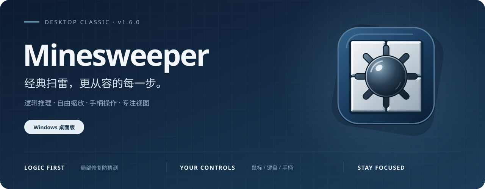
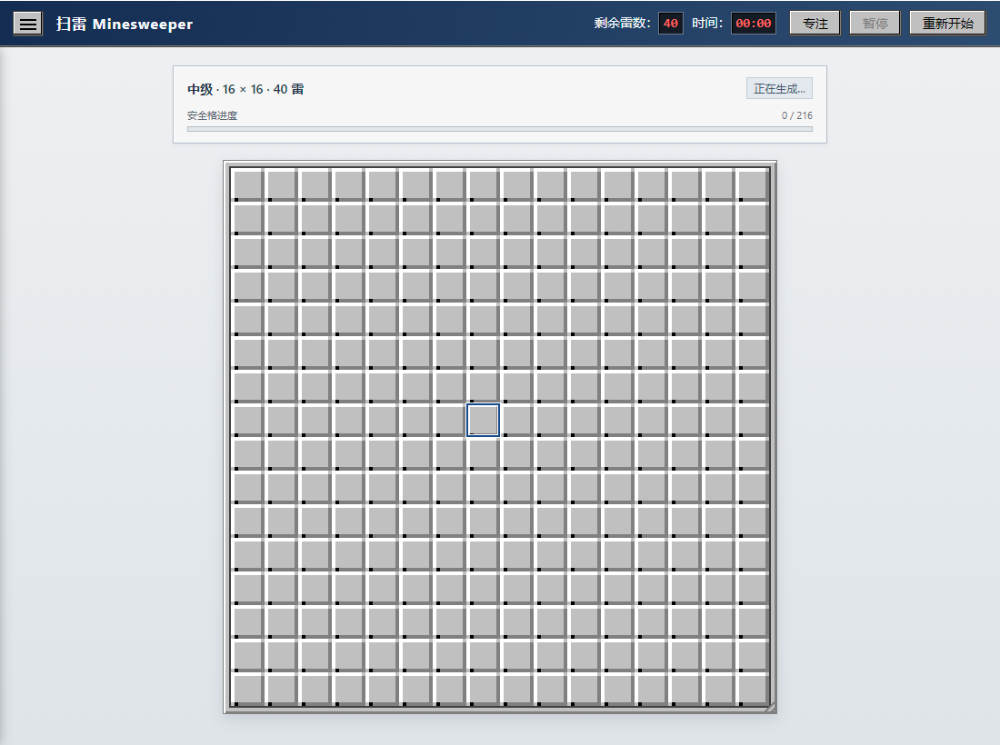
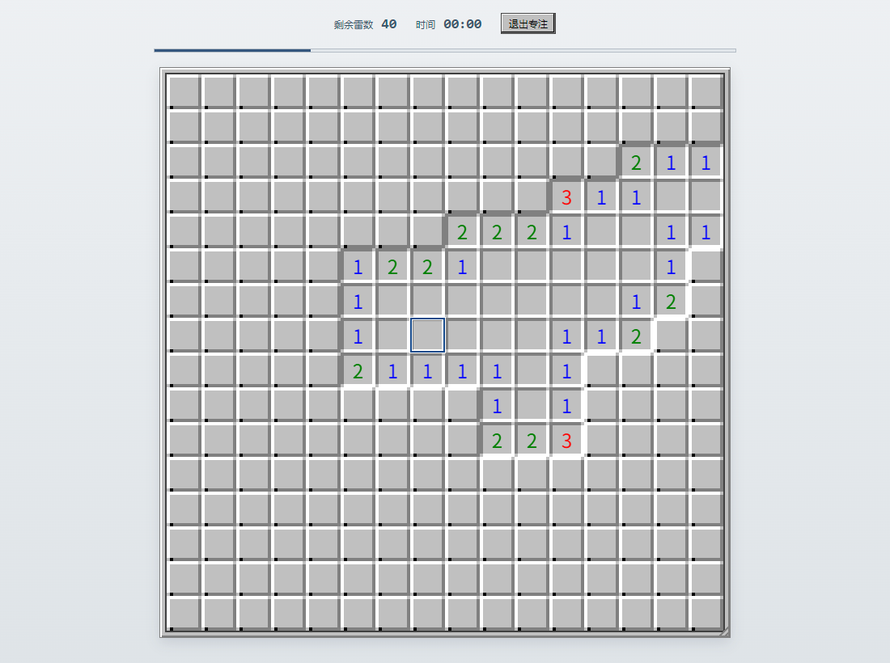

<p align="center">
  
</p>

<h1 align="center">扫雷 Minesweeper</h1>

<p align="center"><strong>经典手感，清晰视野。把注意力留给下一步。</strong></p>

<p align="center">
  <code>v1.6.0</code> · <code>Windows 10 / 11 · x64</code> · <code>中文界面</code> · <code>456 项测试已验收</code>
</p>



<p align="center">
  <a href="https://github.com/Molotov0cocktail/Minesweeper/releases/download/v1.6.0/MinesweeperSetup-1.6.0-win.exe"></a>
  &nbsp;
  <a href="https://gitee.com/Molotov0coaktail/minesweeper/releases/download/v1.6.0/MinesweeperSetup-1.6.0-win.exe"></a>
</p>

<p align="center">
  单文件安装器 · 约 71.3 MiB<br>
  <a href="https://github.com/Molotov0cocktail/Minesweeper/releases/tag/v1.6.0">GitHub 版本说明</a> ·
  <a href="https://gitee.com/Molotov0coaktail/minesweeper/releases/tag/v1.6.0">Gitee 版本说明</a>
</p>

熟悉的浮雕棋盘、金属地雷与鲜明的数字配色，配上适合大屏的自由缩放、专注视图和完整的键盘／手柄操作。这是一款基于 Electron 的 Windows 桌面扫雷：打开一局，按自己的节奏推理。

## 为一局扫雷，做好这些细节

| | |
|---|---|
| **🔍 自由缩放**<br>拖动棋盘右下角即可放大，格子最小 16px，无固定大小上限；也可自动适配窗口，高分屏保持清晰。 | **🧩 局部防猜测**<br>默认开启。先检查逻辑可解性，再修复需要猜测的区域，保留已经取得的局部进展。 |
| **🎯 专注视图**<br>收起顶栏与侧栏，让棋盘、进度、雷数和时间留在眼前。视图切换不打断当前对局。 | **🎮 三种操作方式**<br>鼠标、键盘与标准手柄均可游玩；手柄覆盖菜单、设置与昵称输入，七项动作支持重新绑定。 |
| **🏆 六组排行榜**<br>三种标准难度各分防猜测开／关两组，记录前十名昵称与用时；成绩按本局实际状态归组。 | **⚙️ 从经典到自定义**<br>初级、中级、高级随时选择，也可自行设置行、列和雷数；支持暂停、自动暂停与快速重开。 |

> 防猜测有明确的计算边界：雷密度超过 **50%**、局部修复预算耗尽，或生成超过 **8 秒**／发生失败时，会提示关闭本局防猜测，继续普通开局。首点及周围 **3×3 安全区**始终保留；生成期间可重开取消。

## 实际界面

**经典对局** · 中级 16 × 16 棋盘，40 颗地雷。主要信息集中在顶栏，设置收进侧栏。



**专注视图** · 同一局棋盘，只保留游玩需要的信息。按 F10 或手柄 R3 即可切换。



## 选一局开始

| 难度 | 棋盘 | 地雷 |
|---|---:|---:|
| 初级 | 9 × 9 | 10 |
| 中级 | 16 × 16 | 40 |
| 高级 | 16 × 30 | 99 |
| 自定义 | 行／列各 5～60 | 按棋盘大小设置 |

自定义雷数范围为 `1～min(⌊总格数 × 0.8⌋, 总格数 − 9)`，自定义对局不计入排行榜。设置和排行榜保存在本机。

### 下载、安装与卸载

1. 从上方 GitHub 或 Gitee 下载 `MinesweeperSetup-1.6.0-win.exe`。
2. 双击打开安装向导，选择安装目录以及桌面／开始菜单快捷方式，确认安装。
3. 从快捷方式或安装目录中的 `Minesweeper.exe` 启动游戏。

已安装时，再次运行安装器会显示**卸载确认**；也可从 Windows「卸载程序」进入卸载。卸载按安装清单删除文件，安装目录中自行放入的其他文件会保留并提示。建议保留安装器，Windows 卸载入口会引用它。

安装器自身以便携方式运行，临时数据和日志使用 `%TEMP%`；游戏与独立安装器分离。移动游戏目录后，运行一次游戏可更新安装位置记录，供安装器定位卸载。

### 鼠标、键盘与手柄

| 动作 | 鼠标／键盘 | 标准手柄默认键 |
|---|---|---|
| 移动选中格 | 聚焦棋盘后按方向键 | 十字键／左摇杆 |
| 翻开／确认 | 左键 · Enter／空格 | A／叉 |
| 标记／返回 | 右键 · F 标记 · Escape 返回界面 | B／圆 |
| 打开菜单 | 左上角 ☰ | X／方块 |
| 暂停／继续 | 顶栏按钮 · P | Start |
| 重新开始 | 顶栏按钮 · F2 | 长按 Y／三角 800ms |
| 专注视图 | 顶栏「专注」· F10 | R3 |
| 操作说明 | 菜单「操作说明」· F1 | View／Back／Select |

右键标记按 **旗 → 问号 → 无**循环。已翻开的数字格也可快捷操作：相邻旗数等于数字时，左键翻开其余未标旗邻格；周围未开格数等于数字时，右键将其全部标旗。键盘和手柄的翻开／标记同样支持数字格操作。

拖动右下角缩放手柄可调整显示大小，手动尺寸保留到新局；菜单中选择「自动适配」可恢复窗口适配。切出窗口自动暂停，返回后手动继续。手柄键位可在「手柄与键位」页面修改，发生冲突时自动交换绑定。

## 开发与设计

<details>
<summary><strong>本地运行、测试与打包</strong></summary>

开发环境：Windows、Node.js ≥ 18。技术栈为 **Electron 33 · 原生 ESM · Canvas 2D · module Worker · Vitest**。

```powershell
npm install
npm start
npm test
npm run test:watch
```

若 shell 预设了 `ELECTRON_RUN_AS_NODE=1`，先清除该变量再启动 Electron。集成与构建命令：

```powershell
Remove-Item Env:ELECTRON_RUN_AS_NODE -ErrorAction SilentlyContinue
npx electron scripts/smoke.cjs
npm run icons
npm run dist
node scripts/installer-e2e.cjs
```

`npm run dist` 会自动生成图标、清理旧构建、校验游戏文件白名单并打包；唯一产物为 `dist/MinesweeperSetup-<版本>-win.exe`。`npm run icons` 可独立从 SVG 源重建 PNG 与八尺寸 ICO。构建未配置代码签名。

若 Electron 或构建工具二进制下载失败，可设置镜像后重试：

```powershell
$env:ELECTRON_MIRROR = 'https://npmmirror.com/mirrors/electron/'
$env:ELECTRON_BUILDER_BINARIES_MIRROR = 'https://npmmirror.com/mirrors/electron-builder-binaries/'
npm install --registry=https://registry.npmmirror.com
```

v1.6.0 发布验收：**456 项测试**、默认／双倍缩放下各 **14 项冒烟检查**、**32 项安装端到端检查**通过。GitHub 与 Gitee 提供同一安装包，附件大小与 SHA256 已核对；这是发布验收记录，详见[任务进度](doc/tasks/progress.md)。

</details>

<details>
<summary><strong>防猜测如何判断与修复</strong></summary>

求解先使用单格规则和两集合子集规则，再对共享变量的前沿约束分量完整枚举。每个分量最多 **20 个变量**，每次搜索最多 **100000 个节点**；只有所有可行布局共同确定的格子才用于后续推理，搜索截断不产生确定性结论。因此，超过计算预算的可解局面仍可能触发修复。

修复优先选择较小的含雷歧义簇，在簇内重排，保持簇外雷位；必要时移雷，但总雷数与首点安全区不变。只有未知格严格减少、且没有引入簇外新歧义的调整才会保留，随后继续修复下一处。重复布局复用求解结果。

区域重排次数默认 **20**，可调 **1～200**；真实推理与候选尝试各最多 **400 次**。生成运行在独立 Worker，支持取消和 **8 秒硬超时**。密度、预算或生成异常导致防猜测关闭时，会显示中文提示，成绩计入「防猜测关」榜单。

</details>

<details>
<summary><strong>代码结构与项目文档</strong></summary>

| 目录 | 职责 |
|---|---|
| [`src/core/`](src/core/) | 纯 ESM 核心：棋盘、求解、状态机、设置与排行榜 |
| [`src/renderer/`](src/renderer/) | Canvas 绘制、界面、输入、缩放与 Worker 接线 |
| [`electron/`](electron/) · [`setup/`](setup/) | 游戏主进程、独立安装器与安装向导 |
| [`assets/`](assets/) · [`styles/`](styles/) | 应用图标源与界面样式 |
| [`tests/`](tests/) · [`scripts/`](scripts/) | 契约测试、冒烟、图标处理、构建与安装验收 |
| [`doc/`](doc/) | 需求、设计、任务拆分与验证记录 |

项目按文档驱动、测试先行的流程维护：[需求提案](doc/proposal.md) → [高层设计](doc/high-level-design.md) → [详细设计](doc/detailed-design.md) → [任务进度](doc/tasks/progress.md)。

</details>
